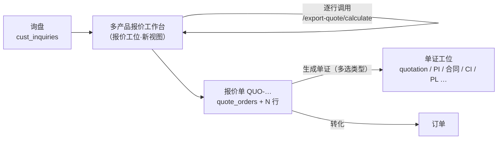

# 多产品报价 + 整单单证 · 实施方案（待决策）

> **需求（用户原话）**：一个客户一个询盘需要多种产品 → 报价要支持**同时报多个产品**，
> 报价中对每个产品**单独展示**，最后对**所有产品汇总展示**；后面能直接给**整个询盘**生成对应的单证
> （报价单 / PI / 形式发票等）。
>
> **本文定位**：先出方案（不写业务代码）。事实依据全部来自代码，逐条给出文件位置；
> 与你确认的决策项集中在 §7。
>
> 制定日期：2026-09-27
> 上位文档：`docs/PLATFORM_UPGRADE_PLAN.md`（P3.3「报价单接线」、P4 工位清单）、
> `docs/WORKSTATION_DESIGN.md`（工位不变量）、`docs/TRADE_DOC_WORKSTATION_PLAN.md`（单证连贯性 G1–G4）、
> `docs/CURRENT_IMPLEMENTATION_MAP.md`（现行/遗留判定）

---

## 0. 一句话结论

**引擎侧与单证侧其实都已经支持"多行"，缺的是报价侧的「多产品工作台」和「报价单」这条链路的接线。**

| 环节 | 能力 | 现状 |
|---|---|---|
| 报价引擎 | 一次请求算一组规格 | ⚠️ **单产品**（`product_key` 单值），但一次可算多行规格 |
| 报价单（持久化） | 一张单含 N 个行项 | ✅ 表与快照链路就绪，❌ **前端不写、线上无接口** |
| 单证渲染 | 多行项 + TOTAL 汇总行 | ✅ 已就绪（前端 TS 渲染器） |
| 单证开单 | 一次开一张、一个上游 | ⚠️ 需扩成"多选类型 / 整批开单" |
| 询盘 → 报价 → 单证 | 业务主链路 | ❌ 中间"报价单"这一环在界面上是断的 |

所以本方案的重心是：**报价工位加一个多产品工作台 → 落成一张报价单 → 单证工位从这张报价单一键生成整套单据**，
引擎契约**零改动**。

---

## 1. 需求拆解（4 件事）

| # | 需求 | 落点 |
|---|---|---|
| **R1** | 一次报价里包含**多个产品**，每个产品有**自己的一套规格与数量** | 报价工位新增「多产品报价」视图 |
| **R2** | 每个产品**单独展示**（规格、数量、单价、小计） | 逐行卡片 |
| **R3** | 对**所有产品汇总**展示（总额、总件数、总重量体积、金额大写） | 汇总卡 |
| **R4** | 给**整个询盘**生成单证（报价单 / PI / 形式发票…） | 先落成「报价单」，再由单证工位整批生成 |

---

## 2. 现状事实（代码依据，非推测）

### 2.1 报价引擎：单产品 / 多行规格

```ts
// shared/contracts/export-quote.ts:138-165
product_key: z.string().min(1),                        // ← 单值：一次只能一个产品
orders: z.array(ExportOrderInSchema).min(1),           // ← 多"订单量方案"（同一产品）
spec_rows: z.array(z.record(z.unknown())).nullable(),  // ← 多"规格行"（同一产品）
```

- 引擎是**纯函数**：只认 `product_key + spec_rows + orders + policy + terms`，不碰数据库
  （`backend/orchestrator/app/services/export_quote/engine.py`）。
- 已注册产品**只有 1 个**：`products/field_fence.py`（牛栏网，`products/__init__.py` 仅 import 它）。
  → 当前"多产品"的实际形态是「同产品多规格行」，但设计必须**按产品无关**来做，立柱/勾花网/石笼网接入时零改动。
- 商品可用列（`products/field_fence.py:286-350`）：`piece.price_per_piece`（元/卷，2 位）、
  `piece.price_per_meter`（元/米，4 位）、`piece.price_per_piece_fx`（报价币/卷，4 位）、
  `derived.weight_per_piece_kg`、`derived.volume_box_per_piece_m3` 等。
  **表里没有"行小计"列** → 行小计需由调用方按 `单卷价 × 件数` 得出（见 §3.4 口径纪律）。

### 2.2 报价工位界面：单产品单规格，且**试算不落库**

- `frontend/src/app/(app)/quotes/views/product-quote-view.tsx`：
  一次只维护一份 `spec`、一份 `pieces`，提交时 `orders: [{ total, unit }]`、`spec_rows: [spec]`
  （payload 组装见该文件 `payload` useMemo）。
- 全程只调 `/export-quote/calculate`（`use-export-quote-calc.ts`），**不创建任何业务记录**
  —— 与平台既定纪律一致：**试算不落台账**（`docs/PLATFORM_UPGRADE_PLAN.md` P4 业务规则）。

### 2.3 报价单（持久化）：表就绪、单证/订单都在用，但**界面不写**

- 表：`quote_orders` + `quote_order_items`（`app/db/workstation_links.py:16-77`），
  行项带 `spec_snapshot`(JSONB) 与 `sort_order` → **天然支持 N 个产品**。
- 开发后端接口：`app/api/quotes.py`（POST 已支持 `items: List[QuoteItemIn]`，见 `quotes.py:46-58`、`create_quote`）。
- 单证冻结快照会读行项：`app/api/trade_docs.py:109-138 _quote_snapshot()`
  → `items[{product_name, qty, qty_unit, unit_price, line_amount, spec_snapshot}]`。
- 订单转化会复制行项：`app/api/orders.py:299-311`。
- 单号与汇率：`ws_common.next_doc_no(..., "quotation")` → `QUO-…`；`lock_fx_rate()` 锁汇率快照。

> ⚠️ **两个必须先讲清楚的事实**（已实测核对）：
> 1. **线上 Worker 没有 `/api/v1/quotes`**。把 `backend/worker/src/main.py` 的 67 个路由全列出来比对，
>    `/quotes` 一个都没有；worker 里只有 `/api/v1/quotations`（报价记录台账）与 `/api/v1/orders`。
>    → 线上目前**无法创建报价单**，单证工位的「报价单」下拉在线上是空的。
> 2. **线上 Worker 也没有 `/export-quote/*`**（`grep export-quote` 在 `worker/src/**` 零命中）。
>    → 出口报价引擎（产品报价视图依赖的 14 个接口）**尚未上线**，只在开发后端可用。
>
> 这两条决定了 §6 的 Wave 5「上线前置」。**不写进计划的隐性假设，就是上线那天的 404。**

### 2.4 `quotes.py` 的现行/遗留判定冲突（需要你给一个例外）

`docs/CURRENT_IMPLEMENTATION_MAP.md` §三 明文：

| 区域 | 判定 |
|---|---|
| 旧报价 CRUD | ⛔ `backend/orchestrator/app/api/quotes.py`（5 个 `/quotes` 接口）—— "前端零调用 + 线上无此路由" → **遗留** |

但现实是：**它是唯一实现"报价单"的模块**，而 `frontend/src/lib/workstation/use-upstream.ts:67`
（单证开单的「报价单」下拉）确实在调 `GET /quotes` —— "零调用"这条判定已经过期。

**建议**：不在这份遗留文件上继续加功能（否则继承它的缺陷），而是
**新建 `app/api/quote_orders.py`（路由前缀仍用 `/api/v1/quotes`）作为现行实现**，
实施时退役 `quotes.py`，并同步更新 `CURRENT_IMPLEMENTATION_MAP.md`。
这条需要你点头（§7 D0）。

### 2.5 单证：多行渲染**已经就绪**，缺的是"开单方式"

- 行项表按类型固定列：`frontend/src/lib/trade-doc/render.ts` 的 `ITEM_COLUMNS`
  （quotation/pi/ci/pl/co/weight_list… 均已含 `no / product_name / specification / qty / qty_unit / unit_price / line_amount / hs_code / gross_weight …`）。
- 自动汇总：`AUTO_SUMS`（`render.ts:466-483`）——`total_qty / total_packages / total_gross_weight / total_net_weight / total_volume`
  = **逐行项数值求和**；`TOTAL_SOURCE`（`:487-491`）把 `qty/package/line_amount` 接到汇总行。
- 行项数据来源：`app/services/trade_doc_payload.py:100 item_from_source()`
  → 从 `spec_snapshot` 摊平出申报要素（`_SPEC_FIELDS = specification/hs_code/package/gross_weight/net_weight/volume`）。
- 开单表单 `trade-docs/components/doc-create-form.tsx`：**单选**类型 + **单选**上游（order / quote / inquiry）。
- 询盘快照 `trade_docs.py:140 _inquiry_snapshot()` **没有行项**（只有 `product_name_raw / quantity`）。

> 结论：**多产品单证的渲染能力已经具备**，只要报价单的行项带齐申报要素，
> 一张 PI 就能逐行列出多种产品并给出 TOTAL。真正缺的是
> ①报价行项怎么来、②一次开多张单。

### 2.6 商品描述归一（G2）是必须补的一环

单证要的是**规范英文描述**（`2.5mm wire, 8/150/15, H1.5m x L50m/roll`），
而引擎给的是**结构化中文工程参数**（`de/inner_wire/height_m/mesh_cm…`）。
`TRADE_DOC_WORKSTATION_PLAN.md §1.5` 已定为三级链路：规则化转换（首选）→ AI 补全（兜底）→ 人工审核（强制）。

**本方案的第一步先做"规则化转换"**（把该产品声明的规格轴映射成英文片段，确定性、可测）：
转换函数放前端 `frontend/src/lib/trade-doc/spec-to-text.ts`，**与渲染器同属一份实现**；
规则未覆盖的产品 → 留空并在界面标黄提示，**不静默填 0、不编造**。

---

## 3. 设计

### 3.1 主链路（本次要打通的）



### 3.2 关键设计选择：报价工作台 = **一张 draft 报价单**

| 选项 | 做法 | 取舍 |
|---|---|---|
| A. 纯前端状态 | 多行只在页面内存里，不落库 | 刷新即丢；"生成单证"没有可挂靠的实体 → ✗ |
| **B. draft 报价单（推荐）** | 工作台直接编辑一张 `status='draft'` 的报价单，行项整批替换 | 复用现有表与快照链路；草稿可续做；"生成单证/转订单"天然有挂靠点。**台账仍只在签发时写**（纪律不变） |
| C. 新建"报价草稿"专表 | 另起 `quote_drafts` | 多一张表 + 一套"草稿→报价单"转换逻辑，收益不抵成本 → ✗ |

选 B 的三条理由：
1. 报价单本来就是"可反复编辑、签发才冻结"的语义（`quotes.py` 状态机 `draft → sent → accepted/rejected/expired`）。
2. 单证、订单两条下游链路**已经在读 `quote_orders`**，不需要任何新的心跳。
3. 符合"最小改动"原则：0 新表（除一个 `inquiry_id` 列，见 §3.5）。

**产物**：工作台顶部显示"未保存/已保存"状态；保存 = 行项整批替换（幂等，无脏行）。

### 3.3 算价：N 行 = N 次调用，引擎**零改动**

```
共享参数（整单级）：客户、询盘、币种、汇率、报价日期、有效期、税务档案/客户档案、贸易术语与费用、利润口径
行级参数：product_key + spec + 按件覆盖 + 件数
```

- 每行组装一个 `ExportQuoteRequest`：`{ ...共享参数, product_key: line.productKey, spec_rows: [line.spec], orders: [{total, unit}], variant_overrides: line.overrides }`。
- 并发 `Promise.allSettled`，**单行失败不阻塞其它行** → 失败行单独标红 + 错误文案（不要把整张报价判死）。
- 不新增 `/export-quote/calculate-batch`：收益是把 N 次网络往返变 1 次，代价是引擎契约变更 +
  **线上 Worker 同步**（本仓库最大风险源）。当前 N 是"一个询盘的品类数"（个位数），不值得。

### 3.4 展示与**汇总口径纪律**（这一段是本次最容易出错的点）

- **逐行卡**：产品名 · 规格摘要（读 `formulas.space` 的 label，不硬编码） · 数量（件数与总数） ·
  单卷价 / 单价 · 行小计 · 该行 diagnostics（如"退税率未核实"）。
  内部视图才显示成本/利润列（沿用 `EngineQuoteResult` 的双视图规则，客户视图剔除 internal 列）。
- **汇总卡**：总金额（按币种）、总件数、总数量、总毛重/净重/体积、金额英文大写。

**口径纪律（必须写进代码注释与单测）**：

| 项 | 口径 |
|---|---|
| 行小计 | `单价 × 数量`，且**必须与单证 Amount 列同源**：推荐 `piece.price_per_piece_fx × 件数`（外币单卷价 × 卷数） |
| 汇总金额 | `Σ 行小计`（**不对已四舍五入的显示值再求和** —— 那正是"界面上 301.00、单证上 301.00 但 TOTAL 差 1 分"的成因） |
| 数量单位 | ✅ 已定：行项 `qty = 卷数`、`qty_unit = ROLLS`、`unit_price = 单卷外币价`；
**总米数（= 卷数 × 每卷米数）只在汇总区展示，不参与金额计算** —— 依据见 §10 |
| 位数 | 沿用产品定义的 `decimals` 与前端 `formatCell`，**屏幕/导出/单证共用同一格式化函数** |
| 与单证一致性 | 单证 `AUTO_SUMS` 是"逐行项求和"；报价工作台的汇总也必须是"逐行求和" → 两边同算法，结果必然一致。**做成一条自动化断言**（§6 验收） |

### 3.5 落库：报价单的行项映射

| 引擎产物 | `quote_order_items` | 备注 |
|---|---|---|
| `meta.product_name` | `product_name` | 单证 Description 用 |
| `line.spec` + `variant_overrides` + 派生英文描述 | `spec_snapshot` | 必含 `specification / hs_code / package / gross_weight / net_weight / volume`（`_SPEC_FIELDS` 白名单） |
| `件数` / `total` | `qty` + `qty_unit` | 见 §7 D3 |
| 单卷外币价（或外币/米） | `unit_price` | 与 `qty` 同一口径 |
| 行小计 | `line_amount` | 见 §3.4 |
| 行序 | `sort_order` | 0,1,2… 决定单证上的行序 |

- 单头：`customer_id / customer_name / currency / fx_rate(锁定) / valid_until / incoterm…`
- **新增关联**：`quote_orders` 加 `inquiry_id` 正列（与 `trade_docs.order_id` 同风格：
  冗余外键、可查询、免 JOIN）。迁移一条，可空，不影响历史数据。
- 状态：工作台保存的始终是 `draft`；`sent` 才写台账（`_record_quote_issued`，已有幂等保护）。

### 3.6 单证：从报价单一键生成"整套"

| 位置 | 交互 |
|---|---|
| 报价工作台汇总卡 | 「生成单证」→ 多选类型（默认勾选"整套"预设）→ 批量开单（带 `quote_order_id`）→ 跳单证工位 |
| 单证工位开单表单 | 类型改**多选**（或"整套"一键勾选）；仍保持"必须挂一个上游"的约束 |
| 单证台账 | 列表加"来源报价单"筛选（后端 `list_trade_docs` 目前只有 `order_id` 筛选，需补 `quote_order_id`） |
| 报价工作台 | 显示"已生成 N 张单证"，可跳转（`trade_doc_quote_refs` 已存在） |

**"整套"预设**（建议，可在 §7 D5 改）：`quotation → pi → contract → ci → pl`
（对应 `PLATFORM_UPGRADE_PLAN.md` §一的业务顺序）。

**明确不做**：不给"询盘直出单证"。询盘快照没有行项（`_inquiry_snapshot`），
强行直出只会生成一张货物栏全空的单据。**必须经报价单**，这也保证"单据金额 = 客户确认过的报价"这一条可追溯。

---

## 4. 改动边界

### Must（核心交付）

| 文件 | 改动 |
|---|---|
| `frontend/src/app/(app)/quotes/views/quote-workbench-view.tsx` | **新建**：共享参数 + N 行 + 汇总 + 保存 + 生成单证 |
| `frontend/src/app/(app)/quotes/components/quote-line-card.tsx` | **新建**：单行（产品/规格/数量/结果）—— 复用现有 `SpecPicker` / `PieceInputField` 形态 |
| `frontend/src/app/(app)/quotes/components/quote-summary-card.tsx` | **新建**：汇总 + 金额大写 + 生成单证入口 |
| `frontend/src/app/(app)/quotes/page.tsx` | 新增平级视图「多产品报价」（tab 名与顺序待定，见 §7 D6） |
| `frontend/src/app/(app)/quotes/hooks/use-quote-order.ts` | **新建**：`GET/POST/PATCH /quotes`、行项整批替换 |
| `frontend/src/app/(app)/quotes/lib/line-to-item.ts` | **新建**：引擎行 → 报价单行项 / `spec_snapshot`（纯函数，可单测） |
| `frontend/src/lib/trade-doc/spec-to-text.ts` | **新建**：结构化规格 → 英文规格描述（规则化，可单测） |
| `frontend/src/app/(app)/trade-docs/components/doc-create-form.tsx` | 类型改多选 + 整批开单 |
| `backend/orchestrator/app/api/quote_orders.py` | **新建**：现行报价单 API（多行 CRUD + 行项整批替换 + `inquiry_id`） |
| 迁移 `2026xxxx_quote_inquiry_link` | `quote_orders.inquiry_id` |
| `shared/contracts/*.ts` | 报价单请求/响应 schema（与 Pydantic 逐字段对齐 —— `contracts:check` 会卡） |

### Should

- `backend/orchestrator/app/api/trade_docs.py::list_trade_docs` 补 `quote_order_id` 筛选。
- `frontend/src/app/(app)/trade-docs/page.tsx` 台账列 + 批量开单入口。
- `backend/worker/src/main.py`：同步 `/api/v1/quotes` 5 个路由（**上线前置**，见 §6 Wave 5）。
- `docs/CURRENT_IMPLEMENTATION_MAP.md`：更新"现行/遗留"表（新增 `quote_orders.py`、退役 `quotes.py`）。

### 明确不改

| 位置 | 理由 |
|---|---|
| `app/services/export_quote/**`（引擎、产品定义、rate_sets） | 契约零改动；多产品由"多次调用"实现 |
| `frontend/src/lib/trade-doc/render.ts` | 多行 + TOTAL 已就绪；只在发现缺口时补 |
| `app/services/trade_doc_payload.py` | 行项摊平逻辑已就绪 |
| `app/api/quotations_api.py`（报价记录台账） | 与本次无关 |
| 单产品报价视图（`product-quote-view.tsx`） | 保留为"快速试算"入口；**不做破坏性重写** |

---

## 5. 风险与对策

| # | 风险 | 对策 |
|---|---|---|
| 1 | **线上缺接口**（`/quotes`、`/export-quote/*` 都不在 worker） | 列入 Wave 5 + 交付门禁；计划里显式写明，不当成"顺便同步" |
| 2 | 汇总金额与单证 TOTAL 差 1 分 | §3.4 口径纪律 + 一条自动化断言（同数据下两处逐位比对） |
| 3 | `spec_snapshot` 缺申报要素 → 单证列空白 | `line-to-item.ts` 用白名单字段 + 缺项在界面标黄；**不静默填 0**（填 0 会让报关表显示 0 重量，比空白更危险） |
| 4 | 破坏单产品路径（现有 195 个前端测试含单证逐字节基准） | 新视图独立文件；`pnpm test` 必须全绿，基准测试不允许改期望值 |
| 5 | Zod 默认丢弃未声明键（本项目踩过） | 新契约字段必须在 schema 里显式声明，且 `contracts:check` 加对抗测试 |
| 6 | 一次改一行就要整批替换行项，可能覆盖并发编辑 | `PATCH` 带 `expected_updated_at`（乐观锁），冲突时提示"已被他人修改"而不是静默覆盖 |
| 7 | 后台不热重载（本项目踩过两次） | 验收一律**打接口**验证，不看代码；改完先杀 8000 端口进程 |

---

## 6. Wave 拆分（文件级隔离，可并行）

| Wave | 内容 | 依赖 |
|---|---|---|
| **W1** | 纯函数与契约层：`spec-to-text.ts`、`line-to-item.ts`、契约 schema、单测 | — |
| **W2** | 后端：`quote_orders.py`（含 `inquiry_id` 迁移）+ 后端测试 | W1 契约 |
| **W3** | 前端工作台：行卡、汇总卡、算价编排、保存 | W1、W2 |
| **W4** | 单证：开单表单多选 + 整批开单 + 台账筛选 | W3（可先 mock） |
| **W5** | 上线前置：worker 同步 `/quotes`（+ `/export-quote/*` 的独立评估） | W2 |
| **W6** | 门禁与文档：契约校验对抗测试、`CURRENT_IMPLEMENTATION_MAP` 更新 | W1–W5 |

---

## 7. 验收标准（量化）

| # | 项 | 判据 |
|---|---|---|
| 1 | 前端类型与测试 | `pnpm typecheck` 0 error；`pnpm test` 全绿（含新增单测 ≥ 8 条：映射、汇总、口径、缺要素提示） |
| 2 | 契约 | `pnpm contracts:check` R0–R4 全绿，且新规则做过"改坏→报错→改回"的对抗验证 |
| 3 | 后端 | `pytest tests/ -q -k "quote or export_quote or trade_doc"` 全绿 |
| 4 | 端到端（开发后端） | 询盘 → 3 个产品行 → 汇总 = 3 行小计之和（**逐分一致**）→ 存为报价单（`QUO-…`，3 行，`sort_order` 0/1/2）→ 从该报价单生成 quotation + PI |
| 5 | **一致性断言** | 报价工作台汇总金额 == 生成的 PI/CI 渲染结果里 `
| 7 | 数量口径 | 单证行项为 `卷数 / ROLLS / 单卷外币价`，`卷数 × 单卷价 = Amount`（逐分精确）；汇总区总米数 = Σ(卷数 × 每卷米数)，与 `Specification` 里写的每卷米数一致 |total_amount` / TOTAL 行金额（同数据逐位相同） |
| 6 | 抗回退 | 单产品路径行为不变；单证 18 类逐字节基准测试**期望值零改动** |

---

## 8. 决策项（请拍板，未定项我会按"推荐"实现）

| # | 问题 | 选项 | 推荐 |
|---|---|---|---|
| **D0** | `quotes.py` 被判"遗留"，但它是唯一报价单实现 | ①新建 `quote_orders.py` 并退役旧的 ②在旧文件上继续加 | **①** |
| **D1** | 本次交付范围 | ①开发环境跑通 + 把线上同步列清单 ②含线上（需先补齐 worker 的 ~50 个接口，见 §9） | **①**（先跑通再排上线）；上线路线见 §9.3，需你选 A/B |
| **D2** | 加工利润 / 让利比例：整单级还是每行级？ | ①整单一份（简单） ②每行可覆盖（不同产品毛利不同） | **②：整单默认 + 行内可覆盖** |
| **D3** | 单证上的数量口径 | — | ✅ **已定（2026-09-27 用户决定）：每行 `Quantity = 卷数`、`Unit = ROLLS`、`Unit Price = 单卷外币价`；每卷米数写进 `Specification` 列 + 汇总区给总米数**。国际惯例依据与完整落法见 §10 |
| **D4** | 工作台入口 | ①报价工位内新 tab（自选客户） ②从「客户/询盘」页"为此询盘报价"进入（带出客户+询盘） | **②为主 + ①为兜底**（两个入口，共用同一组件） |
| **D5** | "整套单证"预设包含哪些 | 默认 `quotation → pi → contract → ci → pl` | 按此，可调 |
| **D6** | 多产品工作台与现有"产品报价"的关系 | ①新增平级 tab「多产品报价」 ②把"产品报价"升级为工作台（单行时就是现在的样子） | **②**：一个入口两种用法，避免同一工位两个页面算出两套口径 |
| **D7** | 是否需要"AI 补全商品英文描述" | ①本次只做规则化 ②同时接 AI（需人工审核） | **①**（AI 那条按 `TRADE_DOC_WORKSTATION_PLAN §1.5` 单独立项） |

---

## 9. 线上缺口实测诊断（2026-09-27）

> 起因：用户发现「线上落后很多版本」。本节是**实测结论**，不是推测；
> 复现命令写在每条结论后面。**它同时是 D1「是否含上线」的事实依据。**

### 9.1 表层：部署分支落后 14 个提交（可 fast-forward，零冲突）

```
git branch --show-current                               → feat/trade-doc-templates
git rev-list --count feature/intel-workstation-v1..HEAD → 14
git rev-list --count HEAD..feature/intel-workstation-v1 → 0     ← 无分叉，可快进
```

部署机制（`.github/workflows/deploy.yml`）：

- **只在 push 到 `feature/intel-workstation-v1` 时触发**；`**.md` / `docs/**` / `.tools/**` 被
  `paths-ignore` **刻意忽略**（每次部署都会让全部 isolate 失效、经历数分钟冷启动窗口，不能因为改文档就重发生产）。
- 所以"改了明明很多、线上没动静"是**预期行为**，不是 CI 坏了。

这 14 个提交在线上的**可见差异**（`git ls-tree -r --name-only 05718bd -- "frontend/src/app/(app)"`）：

| 线上没有 | 说明 |
|---|---|
| `/quotes`（报价工位新页）、`/trade-docs`、`/orders`、`/shipments` | 部署分支的 `frontend/src` 里 `/quotes`、`/trade-docs`、`/orders` 三个路由字符串**零命中** → 侧边栏里**根本没有这四个工位** |
| 18 类单证模板 + 前端 TS 渲染器（`lib/trade-doc/`） | 单证能力整体未上线 |
| `workstations.ts`（工位注册表，单一名表） | 侧边栏/面包屑统一改造未上线 |
| 企业抬头 `tenant_company_profile` + 单证 `render-data` | f795a5e（worker 侧）未上线 → 单据卖方信头为空 |
| Tailwind 语义色透明度修复（1dfedae） | 全站 `bg-muted/40`、`hover:bg-muted/50` 一类样式在线上是失效的 |

### 9.2 深层：**两个后端的接口差集约 50 个**（这才是真问题）

`backend/orchestrator/.venv/Scripts/python.exe scripts/route-parity-audit.py` 实测输出：

| 分类 | 数量 | 含义 |
|---|---|---|
| **【线上坏】** 前端在调 / 开发版有 / 线上没有 | **43** | 一上线就是 404 或 500 |
| 【幽灵】前端在调 / 两个后端都没有 | 18 | ⚠️ 其中 `/api/v1{}/...` 是脚本没展开模板变量 —— `{}` 实为 `/export-quote`；已核对 router 前缀确认它们**只在 orchestrator** |
| 【反向漂移】线上有 / 开发版没有 | 3 | `spec/categories`、`subscriptions`、`subscriptions/bundles` |
| 【正常】前端在调且线上有 | 40 | — |

按域归类的**集中缺口**（已核对 `APIRouter(prefix=…)`，路径准确）：

| 缺口 | 数量 | 只存在于 | 影响 |
|---|---|---|---|
| `/api/v1/export-quote/*` | 14 | orchestrator | **报价工位整体不可用**（算价、产品、规格、导入模板、批量算） |
| `/api/v1/quotes/*` | 5 | orchestrator | **报价单无法创建**；单证工位「报价单」下拉为空 |
| `/api/v1/quote-profiles/*` | 4 | orchestrator | 客户税率档案不可用（报价页该下拉 404） |
| `/api/v1/shipments/*` | 4 | orchestrator | 出货工位整体不可用 |
| `/api/v1/trade-docs/{id}/refresh-sources` | 1 | orchestrator | 单证「从上游重新带入」不可用 |
| AI（providers / task-bindings / tasks / usage） | 6 | orchestrator | AI 能力托管页不可用 |
| outreach（mailboxes / campaigns / messages / generate） | ~10 | orchestrator | 客户触达工位不可用 |
| leadgen / leads / research 若干 | ~10 | orchestrator | 情报类工位部分不可用 |
| admin/spec proposals、`oss/presign`、`auth/register`、`auth/logout`、`market/ports` | ~7 | orchestrator | 零散缺口 |

> ⚠️ **线上当前已有一处断裂（不是本次改动引入的）**：部署分支的
> `frontend/src/app/(app)/quotations/v2-quote/` 已经在调 `/export-quote/import/*`，
> 而 worker 从未实现 `export-quote` → 线上「报价记录」页里的**批量导入面板现在就是坏的**。
> 也就是说"前端超前于后端"这件事**已经发生过一次**，本次不能再叠加。

### 9.3 上线路线（三选一，需你拍板 D1）

| 路线 | 做法 | 收益 | 代价 / 风险 |
|---|---|---|---|
| **A. 分批快进**（推荐先做） | fast-forward 部署分支到 `0b034f0`（"报价工位重写"之前一个提交） | 一次拿到：单证/订单/出货三个工位 + 18 类模板 + 企业抬头 + 样式修复 | 该提交已存在 `/quotes/page.tsx`（旧版，直接嵌 `quotations/v2-quote`）→ **报价入口会变成"点进去算价 404"**。因此路线 A 必须**同时**在 `workstations.ts` 里把报价工位临时 `hidden`，或先补 `export-quote` |
| **B. 先补底座再上**（彻底） | 把 `export-quote`（引擎 + 产品定义 + rate_sets + importers + pricing_table）、`quotes`、`quote-profiles`、`shipments` 落进 worker（或抽 `kaas_common` 共享），再一次性 fast-forward 部署 | 上线即可用：报价多产品 + 报价单 + 单证贯通 | 工作量大：worker 是**刻意精简的单文件**，而 `export-quote` 在 orchestrator 是 10+ 模块（含 yaml 数据与 xlsx 依赖）。这是一条**独立工作流**，建议单独立项排期 |
| **C. 直接全量快进** | 一把推 14 个提交 | 最快 | 上线后 ~50 个接口 404，**报价/单证/出货/AI/触达多页面开箱即坏** → 不可接受 |

**我的建议**：本次按 **D1①（开发环境跑通）** 推进 §6 的 W1–W4；
**上线按路线 A 先摘一次果实**（含"临时隐藏报价入口"这一步，避免新增坏入口）；
路线 B 作为**独立立项**排期（否则"多产品报价"永远只能在自己的开发环境里用）。

### 9.4 核验注意事项

- `git ls-remote` 本例因网络受限（需要代理）**未跑通**，上面的远程状态来自本地 refs
  （`origin/feature/intel-workstation-v1 = 05718bd`）。
  按本仓库既往教训（缓存 ref 可能严重失真），**执行上线前请先**：
  `git ls-remote --heads origin`（挂代理）或 `git fetch --prune` 复核真实 SHA。

---

## 10. 单证数量口径（D3 已定）与国际惯例依据

### 10.1 国际惯例

| 惯例 | 内容 | 对我们的约束 |
|---|---|---|
| **单价 × 数量 = 总价** | 发票/形式发票的硬规则（信用证审单第一条看这个） | `Unit Price` 的分母口径**必须**与 `Quantity` 的 `Unit` 一致，否则单据自相矛盾 |
| **Quantity 只放"计价数量 + 计量单位"** | 常见 `PCS / SETS / ROLLS / M / M2 / KGS` | 「每卷多少米」这类**包装/规格细节不进 Quantity 列** |
| **规格细节走 Description / Specification** | 如 `Chain Link Fence, H1.5m x L50m/roll, 2.5mm wire` | 我们有独立的 `Specification` 列，正好承接"每卷米数" |
| **装箱单看件数与重量体积** | `Packages`（件数）/ `G.W.` `N.W.`(KGS) / `Meas.`(CBM) | 与发票的 Quantity 口径**可以不同**：发票按卷、装箱单按件数+重量 |
| **报关用法定计量单位** | 中国海关的法定第一/第二单位常见为**千克 / 米 / 平方米** | `customs_declaration` 类单据需**额外**给 KGS（不改发票口径） |
| **信用证场景不得自行改单位** | Quantity 描述须与 L/C 一致（含溢短装条款） | 报价时定的单位，签发后一律沿用 |

### 10.2 我们的落法（采纳"每卷多少米 + 有多少卷"）

| 位置 | 呈现 |
|---|---|
| 行项 `Quantity` / `Unit` | **卷数** / `ROLLS` |
| 行项 `Unit Price` / `Amount` | **单卷外币价** / `卷数 × 单卷价`（**精确，无舍入误差**） |
| 行项 `Specification` | `H1.5m x L50m/roll` 式的英文规格，含**每卷米数**、丝径、镀锌量 |
| 汇总区（报价工作台 + 单证 TOTAL 上方） | 总卷数 · **总米数 = Σ(卷数 × 每卷米数)** · 总毛重/净重(KGS) · 总体积(CBM) |
| 装箱单 PL | `Packages = 卷数`、`G.W.`/`N.W.`、`Meas.`（体积用引擎的**长方体体积**口径，与报关一致） |
| 报关信息表 | 在申报要素里额外给 **KGS**（法定单位），发票侧口径不动 |

**为什么不用"按米"作主口径**：引擎现有列里只有 `piece.price_per_meter`（**人民币**/米），
没有"外币/米"；若强行用 `单卷外币价 ÷ 卷长` 反算，4 位舍入会让
`单价 × 数量 ≠ 总价`（差 ±0.01），而这一条正是审单最容易被抓的不符点。
**总米数**因此只作为**汇总信息**展示（不参与金额计算），既满足"每卷多少米"的信息需求，又不破坏乘法恒等。

---

## 11. 与既有文档的关系

- 本文是 `PLATFORM_UPGRADE_PLAN.md` **P3.3「报价单接线」** 与 **P4「报价工位一键生成报价单」** 的具体化实施方案。
- 复用 `TRADE_DOC_WORKSTATION_PLAN.md` §1.3（G1–G4 缺口补法）与 §1.5（商品描述归一的 AI 落点），不重复其内容。
- 遵循 `WORKSTATION_DESIGN.md` §3（单工位自洽 / 松耦合 / 跨工位只读引用）与 §5（关联表模式）。
- 冲突点已在 §2.4 显式标注，需更新 `CURRENT_IMPLEMENTATION_MAP.md`（W6）。
